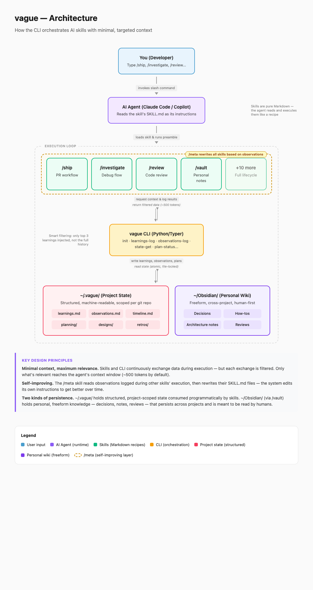

# vague

A Python/Typer CLI that acts as the filesystem contract for 21 markdown-based LLM skills covering the full software development lifecycle, from triage to retro.

Skills are markdown files. `vague` is the stable interface between them and the filesystem: skills call `vague` commands, `vague` reads and writes state under `~/.vague/`. No server, no cloud, no registry.

## Overview

- **21 slash commands** spanning planning, design, execution, reflection, management, and interview prep (see the Skill Map below).
- **One memory ledger** in `~/.vague/memory.jsonl` holds every learning and observation, scoped to a project or `global`. Every skill preamble prints a ranked slice of it (at most 1,500 tokens).
- **Mechanical telemetry:** a Claude Code hook logs each skill start to `~/.vague/events/`, feeding `vague status` with zero agent cooperation.
- **Installs into your runtime** of choice: Claude Code, Cursor, or Windsurf.
- **Clean layering:** `commands/` (thin Typer wrappers) → `core/` (logic) → `models.py` (pydantic). Covered by a fast test suite.

## Quickstart

```bash
git clone https://github.com/atisben/vague.git && cd vague
task install           # editable uv tool install + vague install (auto-detects Claude Code, Cursor, or Windsurf)
```

`task install` installs vague in editable mode, so skills link straight into this repo. Edits to a `SKILL.md` or a template are live at once. Run `task sync` (`vague install`) after adding, renaming, or changing the `Trigger:` line of a skill. Live skills follow the checked-out branch.

Then use any slash command in your AI tool.

---

## Skill Map

### Entry point
| Command | When to use |
|---------|-------------|
| `/triage` | The front door. Triage what's on your plate and route to the right skill. |

### Planning
| Command | When to use |
|---------|-------------|
| `/plan-ideation` | You have an idea. Validates it, challenges it, writes a design doc. Say "think bigger" on an existing plan to expand, hold, or reduce its scope. |
| `/plan-eng` | Lock in architecture, data model, test strategy. |

### Design
| Command | When to use |
|---------|-------------|
| `/diagram` | Build a mind map or an architecture overview as a self-contained HTML diagram. |
| `/vault-excalidraw` | Draw an architecture, flow, map or timeline as a Mermaid flowchart in a vault note, then import it into Excalidraw as editable shapes. |
| `/slides` | Build an animated HTML slide deck (fixed 16:9 stage) from notes or a .pptx: pick a style from three live previews, then export to PDF. |

### Execution
| Command | When to use |
|---------|-------------|
| `/dev-develop` | Orchestrate a feature across fresh-context subagents. |
| `/dev-ship` | Test, version, changelog, commit, push, PR. |
| `/dev-investigate` | Debug systematically — root cause first. |

### Reflection
| Command | When to use |
|---------|-------------|
| `/retro` | Weekly engineering retrospective. |
| `/meta` | Review observations, improve the skills, and curate the memory ledger. |
| `/vault` | Save, search, and export artifacts (HTML diagrams, images) to your Obsidian vault. |

### Management
| Command | When to use |
|---------|-------------|
| `/mgmt-setup` | Set up your team, import a career ladder, add team members. |
| `/mgmt-log` | Log a 1:1, capture feedback or a win for a report. |
| `/mgmt-review` | Run a performance review for a report. |
| `/mgmt-progress` | Team progress, promo readiness, review status. |

### Interview prep
| Command | When to use |
|---------|-------------|
| `/iv-kickoff` | Start interview coaching — profile, resume analysis, cadence. |
| `/iv-research` | Research a company, decode a JD, score the fit. |
| `/iv-stories` | Build and drill your STAR storybank. |
| `/iv-practice` | Drills and mock interviews with scoring. |
| `/iv-progress` | Trends, calibration, readiness verdict. |

---
## System design



---

## Workflow

```
/triage                 → triage + route to any skill below

Idea
  └─ /plan-ideation         → design doc
      ├─ "think bigger"     → scope review (same skill)
      └─ /plan-eng          → architecture locked

      └─ /diagram           → architecture overview
          └─ /vault export  → diagram embedded in an Obsidian note
      └─ /vault-excalidraw  → Mermaid note in the vault, imported into Excalidraw
      └─ /slides            → HTML slide deck (PDF optional)

          └─ /dev-develop   → implement
              └─ /dev-ship  → tests + PR
                  └─ /code-review (built-in) → pre-landing review
                               └─ merge

                              /dev-investigate   (when bugs happen)
                              /retro         (end of week)
```

---

## State

All data lives in `~/.vague/`:

```
~/.vague/
├── config.md
├── memory.jsonl              ← every learning and observation, all projects (append-only)
├── scratch/<scope>.jsonl     ← shared working notes per project, hidden after 7 days
├── events/YYYY-MM.jsonl      ← skill starts and memory reads/writes (powers `vague status`)
├── projects/<owner-repo>/
│   ├── designs/              ← design docs (documents, not memory)
│   ├── diagrams/
│   └── retros/
├── team/                     ← mgmt-* state
└── interview/                ← iv-* state
```

Each memory line has a `scope` (a project slug or `global`) and a `key`. Re-logging a key supersedes it, and `--status forgotten` hides it. Nothing is ever rewritten in place. `vague migrate` moves the old per-project `learnings.md`, `observations.md`, `timeline.md` and `project.md` files into the ledger and the events log, and leaves the originals untouched.

---

## Claude profiles

If you run more than one Claude Code profile — a work account and a personal
one, say — declare them once and `vague install` keeps every profile in sync.

```bash
# ~/.vague/config.env
VAGUE_CLAUDE_DIRS=~/.claude-work:~/.claude-personal
```

`VAGUE_CLAUDE_DIRS` as a real environment variable overrides the file. With
neither set, vague falls back to `CLAUDE_CONFIG_DIR`, then to `~/.claude`.

Each directory becomes its own runtime key, so you can target one or all:

```bash
vague install                            # every detected runtime
vague install --runtime claude           # every configured Claude profile
vague install --runtime claude:work      # just that one
```

### What vague writes into CLAUDE.md

Each instruction file (every Claude profile's `CLAUDE.md`, Cursor's rule) gets
the same public block:

```
<!-- vague:start -->
vague/assets/claude/guidelines.md   ← shared guidelines, shipped with the package
generated skill routing table       ← built from assets/skills/*/SKILL.md
<!-- vague:end -->
```

Only the region between `<!-- vague:start -->` and `<!-- vague:end -->` is
ever rewritten. Personal or per-profile content — work conventions, vault
paths, anything private — goes in that profile's own `CLAUDE.md`, *outside*
the markers. Install leaves it byte-for-byte untouched, and `vague uninstall`
removes the marked region without touching the rest of the file.

If you used the older `~/.vague/claude.d/` fragments, they are no longer read.
`vague install` prints a reminder while the directory exists; move its content
into your `CLAUDE.md` outside the markers, then delete it yourself.

> **Careful where a profile lives.** Claude Code reads `CLAUDE_CONFIG_DIR`,
> but it *also* scans every parent directory of your project for
> `CLAUDE.md` and `.claude/CLAUDE.md`. A profile at `~/.claude` therefore
> loads into every session run from anywhere under `~`, whichever profile
> you actually selected. Naming both profiles explicitly — `~/.claude-work`
> and `~/.claude-personal` — keeps them isolated.

---

## CLI Reference

```bash
vague context --shell --skill dev-ship  # eval-able SLUG=/BRANCH=/... + the MEMORY block
vague status                            # cross-project dashboard: branches, in-flight plans
vague config-get proactive              # read config value
vague config-set proactive false        # write config value
vague memory-log <key> "<text>" --files a,b --skill dev-ship  # log a learning (--global: every repo)
vague memory-log <key> "<issue → fix>" --about dev-ship       # log feedback about a skill
vague memory-log <key> --status forgotten                     # hide a memory
vague memory-search [words...]          # memories containing every word (no words: all), newest first
vague memory-search --scope all         # every scope; also --scope global or --scope <project>
vague migrate --dry-run                 # preview moving the old stores into the ledger
vague slug                              # print SLUG= and BRANCH=
vague commit "msg" --files f1 f2        # atomic git commit
vague skill-validate <dir>              # validate a skill against the contract
vague skill-audit <dir> --strict        # scan for legacy bash patterns
vague install --runtime claude:work     # install/sync one Claude profile
```

---

## Telemetry

The project path is captured **mechanically**: the `vague log-event` hook
logs every skill start to `~/.vague/events/YYYY-MM.jsonl`, with the repo's
main checkout path. No agent cooperation needed, no logging step a model can
skip. `vague status` derives each project's path and last activity from those
events, then runs git checks across all your projects.

Capture is best-effort and can never break a skill: if the write fails, the
error is swallowed and the command output still prints.

### Reading it back

```bash
vague status              # cross-project dashboard: branches, in-flight plans, last activity
```

`/triage` runs `vague status` automatically as its first step, and
`/retro` folds the same data into the weekly retrospective.

### Turning it off

Everything is **100% local** — nothing ever leaves your machine (see
[Telemetry](docs/telemetry.md) for the full inventory of what is and isn't
logged), including how to wire the `vague log-event` hook. To disable event logging:

```bash
vague config-set telemetry off
```

Memories are structural state, not telemetry, so `memory.jsonl` is still
written. Without events, `vague status` has no activity to show.

---

## Observability

`vague` can log every command it runs (name, duration, exit code) plus any
internal errors that would otherwise be swallowed. Logging is **off by default**
and **100% local**: nothing is sent anywhere (see [Telemetry](docs/telemetry.md)).

Turn it on with the `VAGUE_LOG` environment variable:

```bash
export VAGUE_LOG=debug   # debug | info | warning | error (unset = off)
```

Logs are written to a rotating file at `~/.vague/logs/vague.log` (1 MB x 3
backups). A file is the right sink here: each skill step spawns a separate
short-lived `vague` process, and an LLM runtime captures their stderr into its
own context. The file persists across those calls so you can watch one stream.

Run the agent in one terminal and tail the log in another:

```bash
tail -f ~/.vague/logs/vague.log
```

```text
2026-06-04 14:45:19 pid=19944 INFO vague start command=slug
2026-06-04 14:45:19 pid=19944 INFO vague end command=slug exit=0 duration_ms=26.6
```

Set `export VAGUE_LOG=debug` in your shell profile so every `vague` process the
agent spawns inherits it. When running `vague` by hand, add
`VAGUE_LOG_STDERR=1` to also echo logs to your terminal.

---

## Requirements

- Python 3.11+
- `git`
- `gh` CLI (optional, for PR creation in `/dev-ship`)
- Claude Code (or Cursor / Windsurf)

---

## Docs

- [Architecture](docs/architecture.md) — state directory, data model, skill lifecycle
- [Skill authoring](docs/skill-authoring.md) — how to write a new skill
- [Telemetry](docs/telemetry.md) — what is logged and where


## Updates

Pull the latest changes. Skill edits are live with the editable install. Rerun the install only when Python dependencies change or skills were added or renamed:
```bash
task install
```

## Inspirations

- [gstack](https://github.com/garrytan/gstack): An ensemble of advanced skills using bash command to interract with persistent, project checkpoints
- [karpathy's wiki](https://gist.github.com/karpathy/442a6bf555914893e9891c11519de94f): A paradigm for saving persisent files to local wiki that serves as a brain for LLM supported tasks
- [get shit done](https://github.com/gsd-build/get-shit-done): A light-weight meta-prompting, context engineering, and spec-driven development system
- Felix Rieseberg prompt
>  I want a deeper version of this task, not a bigger one. Before rewriting it: (1) say what a top professional in this field would do here that I’m not asking for; (2) name the rawest material they would start from instead of what has already been digested for me; (3) name the specific methods and tools they would use; (4) say what, other than you or me, would show the result is right. Then rewrite my prompt to ask for exactly that
