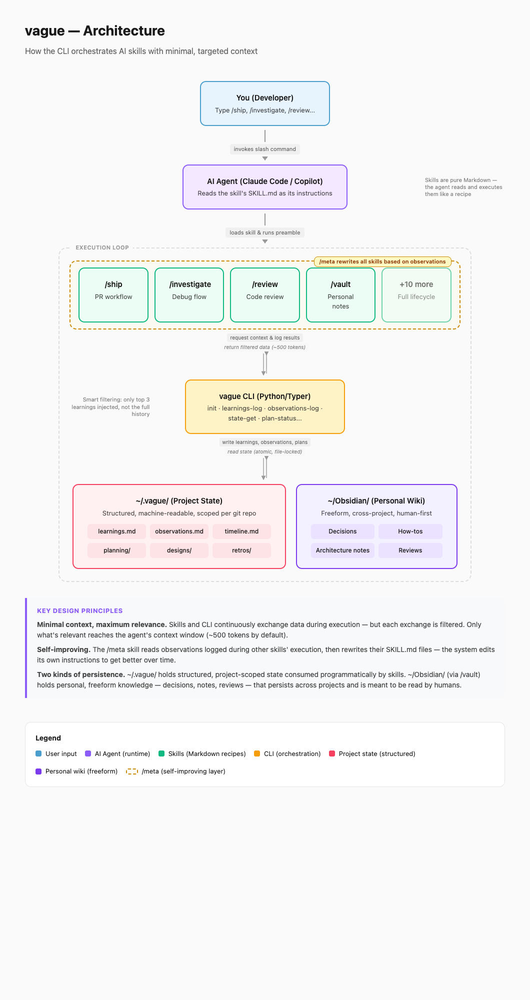

# vague

A Python/Typer CLI that acts as the filesystem contract for markdown-based LLM skills covering the full software development lifecycle, from triage to retro.

Skills are markdown files. `vague` is the stable interface between them and the filesystem: skills call `vague` commands, `vague` reads and writes state under `~/.vague/`. No server, no cloud, no registry.

## Overview

- **Slash commands** spanning planning, design, execution, reflection, management, and interview prep (see the Skill Map below).
- **One memory ledger** in `~/.vague/memory.jsonl` holds every learning and observation, scoped to a project or `global`. Every skill preamble prints a ranked slice of it (at most 1,500 tokens).
- **Mechanical telemetry:** a Claude Code hook logs each skill start to `~/.vague/events/`, feeding `vague status` with zero agent cooperation.
- **Installs into Claude Code:** every Claude profile you declare gets the skills, agents, routing block and hooks.
- **Flat package:** one module per job under `vague/` (`memory.py`, `events.py`, `install.py`, ...), one test file per module.

## Quickstart

```bash
git clone https://github.com/atisben/vague.git && cd vague
task install           # editable uv tool install + vague install (every Claude profile found on disk)
```

`task install` installs vague in editable mode, so skills link straight into this repo. Edits to a `SKILL.md` or a template are live at once. Run `task sync` (`vague install`) after adding, renaming, or changing the `Trigger:` line of a skill. Live skills follow the checked-out branch.

Then use any slash command in your AI tool.

---

## Skill Map

<!-- skills:start -->
### Entry point
| Command | When to use |
|---|---|
| `/triage` | The front door. Triage what's on your plate and route to the right skill. |

### Planning
| Command | When to use |
|---|---|
| `/plan-eng` | Lock in architecture, data model, test strategy. |
| `/plan-ideation` | You have an idea. Validates it, challenges it, writes a design doc. Say "think bigger" on an existing plan to expand, hold, or reduce its scope. |

### Design
| Command | When to use |
|---|---|
| `/diagram` | Build a mind map or an architecture overview as a self-contained HTML diagram. |
| `/impeccable` | Design, critique, audit, or polish a web UI: a design brief kept in memory, three HTML mockups to pick from, then read-only reviewer subagents check the build. |
| `/slides` | Build an animated HTML slide deck (fixed 16:9 stage) from notes or a .pptx: pick a style from three live previews, then export to PDF. |
| `/vault-excalidraw` | Draw an architecture, flow, map or timeline as a Mermaid flowchart in a vault note, then import it into Excalidraw as editable shapes. |

### Execution
| Command | When to use |
|---|---|
| `/dev-implement` | Build a plan inline, or as a task graph of worktree subagents. |
| `/dev-investigate` | Debug systematically — root cause first. |
| `/dev-review` | Review a diff on two axes: Standards and Spec. |
| `/dev-ship` | Test, version, changelog, commit, push, PR. |

### Reflection
| Command | When to use |
|---|---|
| `/retro` | Session retrospective: fix checks, standards and skills, and curate the memory ledger. |
| `/vault` | Save, search, and export artifacts (HTML diagrams, images) to your Obsidian vault. |

### Management
| Command | When to use |
|---|---|
| `/mgmt-log` | Log a 1:1, capture feedback or a win for a report. |
| `/mgmt-progress` | Team progress, promo readiness, review status. |
| `/mgmt-review` | Run a performance review for a report. |
| `/mgmt-setup` | Set up your team, import a career ladder, add team members. |

### Interview prep
| Command | When to use |
|---|---|
| `/iv-kickoff` | Start interview coaching — profile, resume analysis, cadence. |
| `/iv-practice` | Drills and mock interviews with scoring. |
| `/iv-progress` | Trends, calibration, readiness verdict. |
| `/iv-research` | Research a company, decode a JD, score the fit. |
| `/iv-stories` | Build and drill your STAR storybank. |

<!-- skills:end -->

`/impeccable` and its two reviewer agents (`impeccable-finish-reviewer`, `impeccable-motion-reviewer`) are vendored and adapted from [pbakaus/impeccable](https://github.com/pbakaus/impeccable) under Apache-2.0 (see `vague/assets/skills/impeccable/NOTICE.md`). They need subagents, so `vague install` links them into Claude Code runtimes only, never Cursor or Windsurf.

---
## System design



---

## Workflow

```
/triage                 → triage + route to any skill below

Idea
  └─ /plan-ideation         → design doc
      ├─ "think bigger"     → scope review (same skill)
      └─ /plan-eng          → architecture locked

      └─ /diagram           → architecture overview
          └─ /vault export  → diagram embedded in an Obsidian note
      └─ /vault-excalidraw  → Mermaid note in the vault, imported into Excalidraw
      └─ /slides            → HTML slide deck (PDF optional)
      └─ /impeccable        → UI brief, HTML mockups, build review

          └─ /dev-implement → build
              └─ /dev-ship  → tests + PR
                  └─ /dev-review    → Standards + Spec review
                  └─ /code-review (built-in) → pre-landing bug hunt
                               └─ merge

                              /dev-investigate   (when bugs happen)
                              /retro         (after a hard session)
```

---

## State

All data lives in `~/.vague/`:

```
~/.vague/
├── config.env                ← KEY=value: VAGUE_CLAUDE_DIRS, telemetry
├── memory.jsonl              ← one ledger, all projects (append-only): learnings, observations, notes, doc pointers
├── events/YYYY-MM.jsonl      ← skill starts and memory reads/writes (powers `vague status`)
├── team/                     ← mgmt-* state
└── interview/                ← iv-* state
```

Each memory line has a `scope` (a project slug or `global`), a `key` and one of four kinds:

| Kind | What it holds | Lifetime |
|---|---|---|
| `learning` | A durable fact | Forever |
| `observation` | Feedback about a skill (`--about`) | Until `/retro` actions it |
| `note` | A working note for other agents (`--scratch`) | Hidden after 7 days |
| `doc` | A pointer to a document a skill wrote (`--doc`) | Forever |

Documents themselves never live in `~/.vague/`. Design docs, eng plans and diagrams are Obsidian vault notes, and a deck is an HTML file in your working directory. The ledger keeps only a `doc` pointer to each, keyed by branch or date (`eng-plan-<branch>`, `diagram-<name>`), so a newer document replaces the older pointer.

Re-logging a key supersedes it, and `--status forgotten` hides it. Nothing is ever rewritten in place.

---

## Claude profiles

If you run more than one Claude Code profile — a work account and a personal
one, say — declare them once and `vague install` keeps every profile in sync.

```bash
# ~/.vague/config.env
VAGUE_CLAUDE_DIRS=~/.claude-work:~/.claude-personal
```

`VAGUE_CLAUDE_DIRS` as a real environment variable overrides the file. With
neither set, vague falls back to `CLAUDE_CONFIG_DIR`, then to `~/.claude`.

Each directory becomes its own runtime key, so you can target one or all:

```bash
vague install                            # every detected runtime
vague install --runtime claude           # every configured Claude profile
vague install --runtime claude:work      # just that one
```

### What vague writes into CLAUDE.md

Each instruction file (every Claude profile's `CLAUDE.md`) gets
the same public block:

```
<!-- vague:start -->
vague/assets/claude/guidelines.md   ← shared guidelines, shipped with the package
generated skill routing table       ← built from assets/skills/*/SKILL.md
<!-- vague:end -->
```

Only the region between `<!-- vague:start -->` and `<!-- vague:end -->` is
ever rewritten. Personal or per-profile content — work conventions, vault
paths, anything private — goes in that profile's own `CLAUDE.md`, *outside*
the markers. Install leaves it byte-for-byte untouched, and `vague uninstall`
removes the marked region without touching the rest of the file.

> **Careful where a profile lives.** Claude Code reads `CLAUDE_CONFIG_DIR`,
> but it *also* scans every parent directory of your project for
> `CLAUDE.md` and `.claude/CLAUDE.md`. A profile at `~/.claude` therefore
> loads into every session run from anywhere under `~`, whichever profile
> you actually selected. Naming both profiles explicitly — `~/.claude-work`
> and `~/.claude-personal` — keeps them isolated.

---

## CLI Reference

```bash
vague context --shell --skill dev-ship  # eval-able SLUG=/BRANCH=/... + the MEMORY block
vague status                            # cross-project dashboard: branches, in-flight plans
vague ui                                # usage graph on localhost: projects, branches, skills, memories, files
vague config-get telemetry              # read config value
vague config-set telemetry off          # write config value
vague memory-log <key> "<text>" --files a,b --skill dev-ship  # log a learning (--global: every repo)
vague memory-log <key> "<issue → fix>" --about dev-ship       # log feedback about a skill
vague memory-log <key> "<note>" --scratch --skill dev-implement  # leave a note for other agents (hidden after 7 days)
vague memory-log <key> "<summary>" --doc --files <abs path> --skill plan-eng  # point at a document a skill wrote
vague memory-log <key> --status forgotten                     # hide a memory
vague memory-search [words...]          # memories containing every word (no words: all), newest first
vague memory-search --scope all         # every scope; also --scope global or --scope <project>
vague memory-search --kind doc --skill plan-eng  # filter by kind (learning|observation|note|doc) and skill
vague skill-check [paths...]            # check skills against the rules (no path: every skill + README/CLAUDE.md)
vague install --runtime claude:work     # install/sync one Claude profile
```

---

## Telemetry

Everything vague records stays on this machine. A Claude Code hook logs each skill start to
`~/.vague/events/`, which feeds `vague status`. An opt-in debug log (`VAGUE_LOG=debug`) records every
command. [Telemetry](docs/telemetry.md) is the one place that lists what is logged, what never is,
and how to turn each part off.

---

## Requirements

- Python 3.11+
- `git`
- `gh` CLI (optional, for PR creation in `/dev-ship`)
- Claude Code

---

## Docs

- [Architecture](docs/architecture.md) — state directory, data model, skill lifecycle
- [Skill authoring](docs/skill-authoring.md) — how to write a new skill
- [Telemetry](docs/telemetry.md) — what is logged and where


## Updates

Pull the latest changes. Skill edits are live with the editable install. Rerun the install only when Python dependencies change or skills were added or renamed:
```bash
task install
```

## Inspirations

- [gstack](https://github.com/garrytan/gstack): An ensemble of advanced skills using bash command to interract with persistent, project checkpoints
- [karpathy's wiki](https://gist.github.com/karpathy/442a6bf555914893e9891c11519de94f): A paradigm for saving persisent files to local wiki that serves as a brain for LLM supported tasks
- [get shit done](https://github.com/gsd-build/get-shit-done): A light-weight meta-prompting, context engineering, and spec-driven development system
- Felix Rieseberg prompt
>  I want a deeper version of this task, not a bigger one. Before rewriting it: (1) say what a top professional in this field would do here that I’m not asking for; (2) name the rawest material they would start from instead of what has already been digested for me; (3) name the specific methods and tools they would use; (4) say what, other than you or me, would show the result is right. Then rewrite my prompt to ask for exactly that
